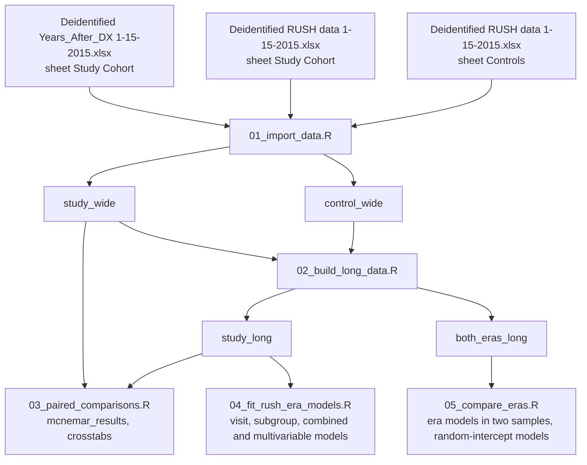

# Architecture

The current implementation: scripts, data flow, and the objects passed between them. Written on 8 November 2026 against every script in `R/` and `tests/synthetic/`. The scripts have been run on synthetic data only; they have not yet been run on the study data.

## Running order

`R/main.R` sources the scripts in this order. Each script runs in the global environment and leaves the objects listed for later scripts. No script writes a file.

| Order | Script | Needs | Produces | Data |
|---|---|---|---|---|
| 1 | `R/setup.R` | — | Attached packages; every constant | — |
| 2 | `R/functions.R` | Packages | Helper functions | — |
| 3 | `R/01_import_data.R` | 1, 2; `RUSH_DATA_DIR` | `study_wide`, `control_wide` (one row per patient) | Study data |
| 4 | `R/02_build_long_data.R` | 1 to 3 | `study_long`, `control_long` (two rows per patient); `both_eras_long` (up to four) | Study data |
| 5 | `R/03_paired_comparisons.R` | 1 to 4 | `mcnemar_results`, `crosstabs` | Results from study data |
| 6 | `R/04_fit_rush_era_models.R` | 1 to 4 | `visit_models`, `visit_effects`; `subgroup_models`, `subgroup_tests`, `subgroup_effects`; `combined_models`, `combined_tests`, `combined_effects`; `multivariable_models`, `multivariable_effects` | Results from study data |
| 7 | `R/05_compare_eras.R` | 1 to 4 | `era_samples`; `era_models`, `era_effects`; `era_subgroup_models`, `era_subgroup_tests`; `random_effects_models`, `random_effects_effects` | Results from study data |

## Data flow

## Key mechanisms

- **Within-patient models.** Every conditional model goes through `fit_conditional_logit()`, which adds `strata(patient_number)` and uses the exact conditional likelihood. Characteristics constant within a patient appear only in interactions with `post_visit` (and, in `05`, `rush_era`), never as main effects.
- **Stata's category numbering.** `encode_like_stata()` orders factor levels by byte order, so reference levels match the original code's `encode`. `clean_cohort()` applies it to race, sex and age group in both sheets.
- **Race groups from codes, per sheet.** `group_race_codes()` maps `race_code` to `race_group` with `race_group_codes_study` or `race_group_codes_control` (`setup.R`); `02` prints the code-to-value table. The stacked data use `race_group`, sex and age group as text-labelled factors, never codes.
- **Reported quantities.** `effect_by_level()` (Stata's `lincom`) and `wald_test()` (Stata's `testparm`) work from `model_coefficients()`, which handles both `clogit()` and `glmer()` models. Interaction coefficient names come from `interaction_terms()`, built from `model$xlevels`, so they match exactly.
- **Results in nested named lists.** Repeated fits are for-loops over names into lists indexed `[[characteristic]][[outcome]]`, or `[[sample]][[outcome]]` in `05`.
- **Skipped models in one place.** `skipped_rush_subgroup_models` and `skipped_era_subgroup_models_all` (`setup.R`) list the models the original code could not fit; `04` and `05` skip them by lookup.
- **Two era samples.** `era_samples` holds `all_patients` and `both_eras` (patients with `rows_per_patient_both_eras` rows); every model in `05` loops over both.
- **Inputs are checked.** `01` stops if `RUSH_DATA_DIR` is unset or a workbook lacks an expected column; the message names columns only. The years-since-diagnosis merge stops on a duplicated patient number.

## Dependencies outside this repository

- **The study data**, in the folder named by `RUSH_DATA_DIR`: the two de-identified workbooks. Neither is in the repository; their columns have not been checked against the code.
- **Packages** attached in `setup.R`: tidyverse, readxl, survival and lme4. The synthetic test also needs writexl.

## Website

Each definitive script has a page in `quarto/` that imports its labelled sections with `knitr::read_chunk()` and shows them without running them. `quarto/original_stata.qmd` reads `stata/RUSH_analysis_2015-01-15.do` as text. `.github/workflows/publish.yml` renders the site and publishes it to `gh-pages`.

## Tests

`tests/synthetic/build_synthetic_data.R` writes random workbooks with the expected sheets, columns and value formats. `tests/synthetic/run_pipeline.R` runs `R/main.R` on them and checks that: the conditional odds ratio for paired data equals the ratio of discordant pairs; `effect_by_level()` equals a model fitted within each age group; `wald_test()` equals survival's Wald test and the squared z statistic; every interaction test found its coefficients; the restricted era sample has four rows per patient; and `paired_mcnemar()` equals `mcnemar.test()`. `.github/workflows/test-pipeline.yml` runs it on every pull request.

## Code references

| Script | Labelled sections | Key symbols |
|---|---|---|
| `R/setup.R` | `load-packages`, `define-data-files`, `define-expected-columns`, `define-categories`, `define-outcomes`, `define-subgroups`, `define-skipped-models`, `define-estimation-constants` | `data_dir`, `cohort_columns`, `control_columns`, `place_columns`, `years_since_dx_levels`, `race_group_codes_study`, `race_group_codes_control`, `outcomes`, `subgroups_rush`, `subgroups_era`, `quadrature_points`, `rows_per_patient_both_eras` |
| `R/functions.R` | `check-columns`, `encode-like-stata`, `clean-cohort`, `group-race-codes`, `reshape-to-long`, `add-viral-load-outcomes`, `paired-mcnemar`, `crosstab-row-percent`, `fit-conditional-logit`, `model-coefficients`, `combine-coefficients`, `interaction-terms`, `effect-by-level`, `wald-test`, `tidy-odds-ratios` | `encode_like_stata()`, `clean_cohort()`, `fit_conditional_logit()`, `effect_by_level()`, `wald_test()` |
| `R/01_import_data.R` | `check-data-folder`, `read-years-since-diagnosis`, `read-study-cohort`, `merge-years-since-diagnosis`, `clean-study-cohort`, `describe-study-cohort`, `read-control-cohort` | `study_wide`, `control_wide` |
| `R/02_build_long_data.R` | `reshape-study-cohort`, `group-race-study`, `reshape-control-cohort`, `group-race-control`, `stack-eras` | `study_long`, `control_long`, `both_eras_long` |
| `R/03_paired_comparisons.R` | `mcnemar-tests`, `crosstabs-by-characteristic` | `mcnemar_results`, `crosstabs` |
| `R/04_fit_rush_era_models.R` | `fit-visit-models`, `fit-subgroup-models`, `test-subgroup-interactions`, `estimate-subgroup-effects`, `fit-combined-models`, `fit-multivariable-models` | `visit_models`, `subgroup_tests`, `subgroup_effects`, `multivariable_models` |
| `R/05_compare_eras.R` | `define-era-samples`, `fit-era-models`, `fit-era-subgroup-models`, `fit-random-effects-models` | `era_samples`, `era_models`, `era_subgroup_tests`, `random_effects_models` |

## Glossary

| Term | Definition |
|---|---|
| `post_visit` | 0 for the window before the visit, 1 for the window after it (Stata's `Intervention`) |
| `rush_era` | 1 for the RUSH-era index visit, 0 for the pre-RUSH visit (Stata's `RUSHEra`) |
| `race_code` | Stata `encode` number of the recorded race text, within one sheet |
| `race_group` | Black, Hispanic, White, Asian/Other/Unknown (Stata's `NewRace`) |
| `vl_suppressed_missing_fail` | Viral suppression with a missing result counted as not suppressed; the primary viral load outcome (Stata's `ViralLoadMissEqFail`) |
| `vl_suppressed` | Viral suppression with a missing result missing (Stata's `ViralLoad`) |
