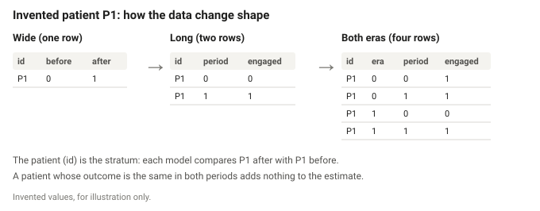

This script makes each cohort into one row per patient and period, adds the viral load outcomes and the race groups, and stacks the two eras. It produces `study_long` for [3. Paired comparisons](03_paired_comparisons.qmd) and [4. RUSH-era models](04_fit_rush_era_models.qmd), and `both_eras_long` for [5. Comparison with the pre-RUSH era](05_compare_eras.qmd).

::: {.teaching-figure}
{fig-alt="Three small tables for an invented patient P1. Wide: one row with engagement before 0 and after 1. Long: two rows, period 0 and period 1. Both eras: four rows, for era 0 and era 1, each with period 0 and 1. The patient is the stratum in every model."}
:::

::: {.Rcode title="Source code"}
The full R script is available at:

-   [`R/02_build_long_data.R`](https://github.com/VagishHemmige/Harris-Health-RUSH/blob/main/R/02_build_long_data.R)

This R script file is itself reliant on the following helper files:

-   [`R/setup.R`](https://github.com/VagishHemmige/Harris-Health-RUSH/blob/main/R/setup.R)
-   [`R/functions.R`](https://github.com/VagishHemmige/Harris-Health-RUSH/blob/main/R/functions.R)

The code sections below are imported directly from that script when this page is rendered.
:::

```{r}
#| include: false
#| eval: true
#| cache: false
knitr::read_chunk("../R/02_build_long_data.R")
```

```{r}
#| include: false
#| eval: true
# Splits the original .do file into parts, as text, for the folded boxes
source("_stata_sections.R")
```

## Reshape the study cohort

Conditional logistic regression needs one row per observation, so each patient becomes two rows: the period before the visit (`post_visit` = 0) and after it (`post_visit` = 1). Then the viral load text becomes the two binary outcomes. Both steps are functions on [Functions](functions.qmd#reshape-to-one-row-per-period), because the control cohort needs exactly the same.

The original code calls the period variable `Intervention`. It is not the program: every patient in this cohort had the program. It is the period relative to the visit, which is why it is named `post_visit` here.

```{r}
#| label: reshape-study-cohort
#| eval: false
```

::: {.callout-note collapse="true" title="Original Stata code"}
```{r}
#| echo: false
#| eval: true
#| output: asis
show_stata(c("reshape"))
```
:::

## Race groups in the study cohort

Two race variables, as in the original code: an African American indicator, from race code 2, and the four race groups, from the study sheet's code list ([Setup](setup.qmd#categories)). The indicator is a factor with "No" first, so "No" is the reference, as Stata's `i.AfricanAmerican` makes 0 the base. `rush_era` is 1 for every row.

The printed table has one row per race code, with the recorded text it stands for, its group, and the number of rows. This is what the original code's `tab NewRace Race` showed, and it is how an authorized analyst checks that each code is grouped as intended.

```{r}
#| label: group-race-study
#| eval: false
```

::: {.callout-note collapse="true" title="Original Stata code"}
```{r}
#| echo: false
#| eval: true
#| output: asis
show_stata(c("race"))
```
:::

## Reshape the control cohort

The same reshaping and viral load outcomes for the pre-RUSH visits.

```{r}
#| label: reshape-control-cohort
#| eval: false
```

## Race groups in the control cohort

The same two variables from the control sheet's own codes, with `rush_era` 0. The control sheet has fewer distinct race values, so `encode` numbered them differently: in the original code, White is code 5 here but codes 4 and 7 in the study sheet. Using the wrong list would silently misgroup patients, which is why each sheet has its own.

```{r}
#| label: group-race-control
#| eval: false
```

## Stack the eras

Both cohorts in one data frame, sorted by patient, era and period, as the original code's `append` and `sort`. A patient with visits in both eras now has four rows.

Two things are done differently from the original code, and both are listed on [Differences from the original code](differences.qmd#differences-that-could-change-a-number). The race codes are not comparable between the sheets, so only the race groups are used from here on, and race as recorded is kept as text. Sex and age group are stacked as their recorded text and then given the study cohort's category order, so a value that is missing from one sheet cannot shift the meaning of the other sheet's codes, as it could have when Stata appended the numbered versions.

```{r}
#| label: stack-eras
#| eval: false
```

::: {.callout-note collapse="true" title="Original Stata code"}
```{r}
#| echo: false
#| eval: true
#| output: asis
show_stata(c("stack"))
```
:::
