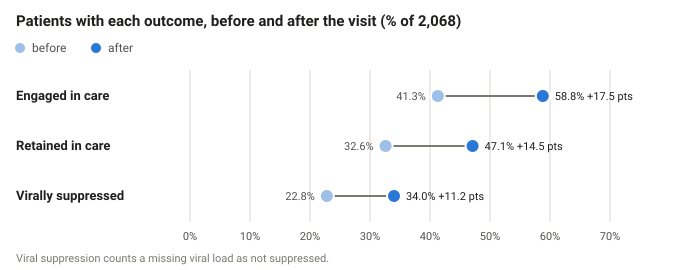
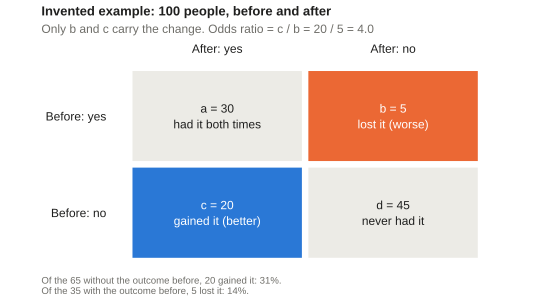
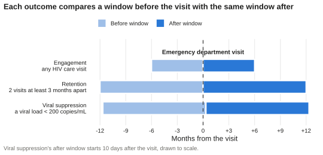

This script draws the site's teaching figures with ggplot2 and saves them as SVG files, which the other pages show. It is not part of the analysis: `R/main.R` does not run it, and it reads no study data. Its numbers are the ones the article prints, typed into [`quarto/published/tables_2_to_4.csv`](https://github.com/VagishHemmige/Harris-Health-RUSH/blob/main/quarto/published/tables_2_to_4.csv), the abstract's percentages, and the invented example of [Methodological background](methodological_background.qmd#paired-binary-data). Run it from the project root with `Rscript R/teaching_figures.R` after changing a figure, and commit the files it writes.

::: {.Rcode title="Source code"}
The full R script is available at:

-   [`R/teaching_figures.R`](https://github.com/VagishHemmige/Harris-Health-RUSH/blob/main/R/teaching_figures.R)

This R script file is itself reliant on the following helper files:

-   [`R/setup.R`](https://github.com/VagishHemmige/Harris-Health-RUSH/blob/main/R/setup.R), whose `define-teaching-figure-constants` section holds the abstract's percentages, the invented example, the outcome windows and the colours
-   [`R/functions.R`](https://github.com/VagishHemmige/Harris-Health-RUSH/blob/main/R/functions.R), for `parse_odds_ratio_text()`

The code sections below are imported directly from that script when this page is rendered.
:::

```{r}
#| include: false
#| eval: true
#| cache: false
knitr::read_chunk("../R/teaching_figures.R")
knitr::read_chunk("../R/setup.R")
knitr::read_chunk("../R/functions.R")
```

## The figures' numbers

The constants in `R/setup.R`: the abstract's percentages, the invented 2 × 2 example, the windows of each outcome in months, and the colours. Before and after are two shades of one blue; worse and better are orange and blue, which stay distinct for readers with colour-blindness.

```{r}
#| label: define-teaching-figure-constants
#| eval: false
```

The article prints each odds ratio as text, such as "3.74 (3.09–4.53)". This helper turns that text into three numbers; "∞\*" and "-" give missing values.

```{r}
#| label: parse-odds-ratio-text
#| eval: false
```

## One look for every figure

A plain theme, used by every figure: no grey panel, light vertical grid lines only, and text in dark grey rather than in the data colours. `save_teaching_figure()` writes an SVG file at a fixed width, with `svglite`, so the text in the figure stays text.

```{r}
#| label: figure-theme
#| eval: false
```

## Before and after, by outcome {#change-by-outcome}

A dot for each period, joined by a line, with the change in percentage points written beside it. The data are reshaped to one row per outcome and period for the dots, and kept wide for the lines and labels.

```{r}
#| label: figure-change-by-outcome
#| eval: false
```

::: {.teaching-figure}
{fig-alt="Dot plot of the percentage of 2,068 patients with each outcome before and after the visit. Engaged in care: 41.3% before, 58.8% after, up 17.5 points. Retained in care: 32.6% to 47.1%, up 14.5 points. Virally suppressed: 22.8% to 34.0%, up 11.2 points."}
:::

## Forest plots of Tables 2 to 4 {#forest-plots}

Each category's odds ratio and 95% interval, on a log scale so that an odds ratio of 2 and one of 0.5 sit the same distance from 1. `facet_grid()` gives each characteristic its own panel, labelled with its across-groups P value, and `space = "free_y"` keeps every row the same height. A category in which no patient got worse has an infinite odds ratio, so it gets a note in place of a dot. The loop draws one plot per table.

```{r}
#| label: figure-forest-plots
#| eval: false
```

::: {.teaching-figure}
. Tables 3 and 4 are drawn the same way.](teaching_figures/forest_table_2.svg){fig-alt="Forest plot of the odds ratio for engagement after versus before the visit, for each category of sex, race, age group, year of visit and years since diagnosis, and the total, 3.74 (3.09 to 4.53). All intervals except Other race, which runs from 0.58 to 42.8, lie above 1."}
:::

## Discordant pairs {#discordant-pairs}

The invented example as a 2 × 2 table of pairs, drawn with `geom_tile()`. The two cells where the outcome changed are coloured. The subtitle and caption are computed from the example's four numbers, so they stay right if the numbers change.

```{r}
#| label: figure-discordant-pairs
#| eval: false
```

::: {.teaching-figure}
{fig-alt="Invented example of 100 people. A two-by-two table: 30 had the outcome both times, 45 never had it, 5 lost it and 20 gained it; the 5 and the 20 are highlighted. The odds ratio is 20 divided by 5, 4.0. Of the 65 without the outcome before, 20 gained it, 31%; of the 35 with it, 5 lost it, 14%."}
:::

## The windows of each outcome {#outcome-windows}

One bar per outcome and period, drawn with `geom_rect()` in months from the visit. The windows come from the analysis plan, section 7.

```{r}
#| label: figure-outcome-windows
#| eval: false
```

::: {.teaching-figure}
{fig-alt="Timeline from 12 months before to 12 months after the emergency department visit. Engagement compares the 6 months before with the 6 months after. Retention compares the 12 months before with the 12 months after. Viral suppression compares 12-month windows whose dividing line is 10 days after the visit."}
:::

## Learn more

- [*R for Data Science*, "Data visualisation"](https://r4ds.had.co.nz/data-visualisation), Hadley Wickham and Garrett Grolemund (free online): the ggplot2 grammar of graphics, layers, scales and facets. This is the first edition; the page links to the second edition's chapter.
